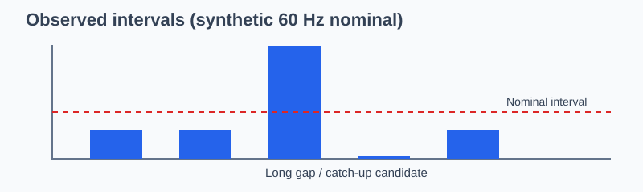

# Delivered gaze samples are not the nominal sampling rate

This October 2026 **research-only** module audits the timestamp process and preserves the distinction between requested rate, native rate, SDK rate and downstream analysis grid. No hardware sampling rate or cross-device event synchronization is inferred from interpolation.

## Worked deterministic example

~~~python
from research.october_2026.acquisition_and_dispersion import acquisition_integrity_certificate

certificate = acquisition_integrity_certificate(
    [0, .010, .020, .060, .061, .071],
    native_rate_hz=60,
    sdk_rate_hz=60,
    analysis_grid_rate_hz=500,
)
print(certificate)
~~~

The long interval followed by a short one is a catch-up *candidate*, not proof of which software or hardware layer introduced the irregularity. Report tails, gaps and validity flags alongside empirical effective rate.

## Original plotted diagnostic

~~~python
import matplotlib.pyplot as plt
timestamps = [0, .010, .020, .060, .061, .071]
dt_ms = [1000 * (b - a) for a, b in zip(timestamps, timestamps[1:])]
fig, ax = plt.subplots(figsize=(7, 3))
ax.bar(range(1, len(dt_ms) + 1), dt_ms)
ax.axhline(1000 / 60, color="k", linestyle="--", label="Nominal 60 Hz")
ax.set(xlabel="Observed sample interval", ylabel="Duration (ms)")
ax.legend()
fig.tight_layout()
~~~

A separate `dispersion_interpretation_audit()` requires target visual angle, eccentricity, task and calibration-versus-task context before a BCEA68-style quantity is interpreted. Task fixation dispersion is not automatically an instrument precision estimate.

**Claims not authorized:** externally validated sampling stability, spatial calibration accuracy, sensor clock drift or causal attribution of observed burst patterns. The image and plot code use synthetic timestamps only.
